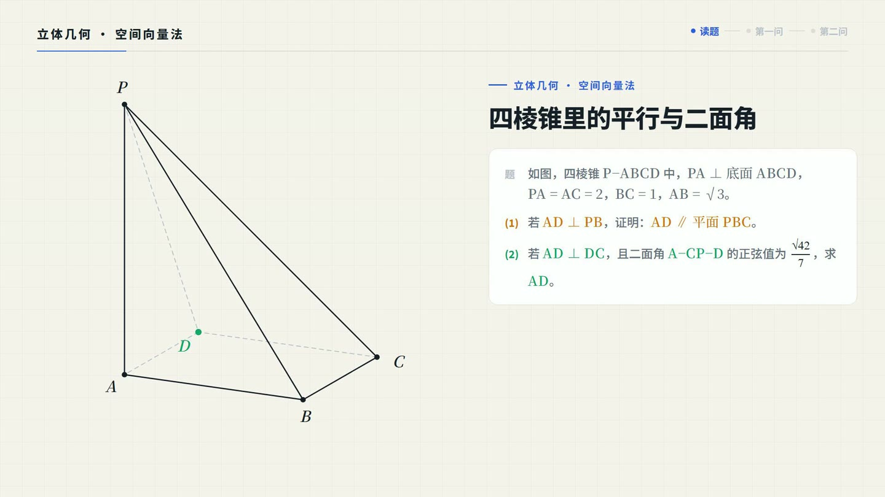
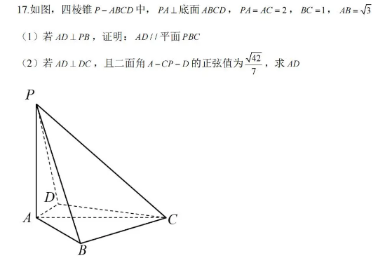
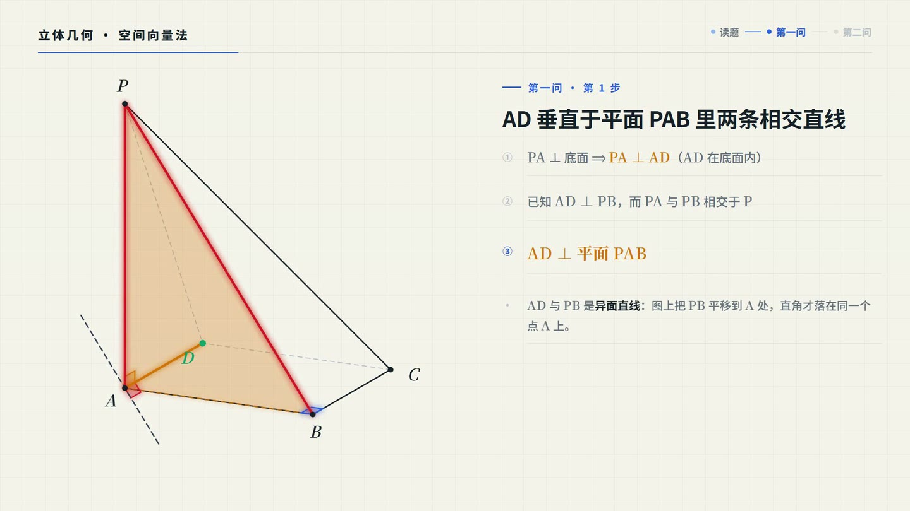
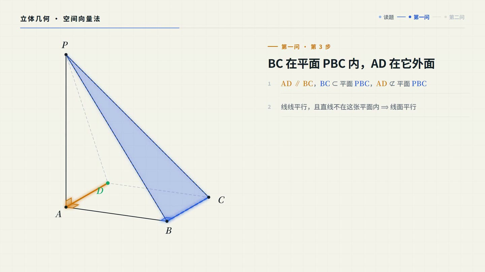
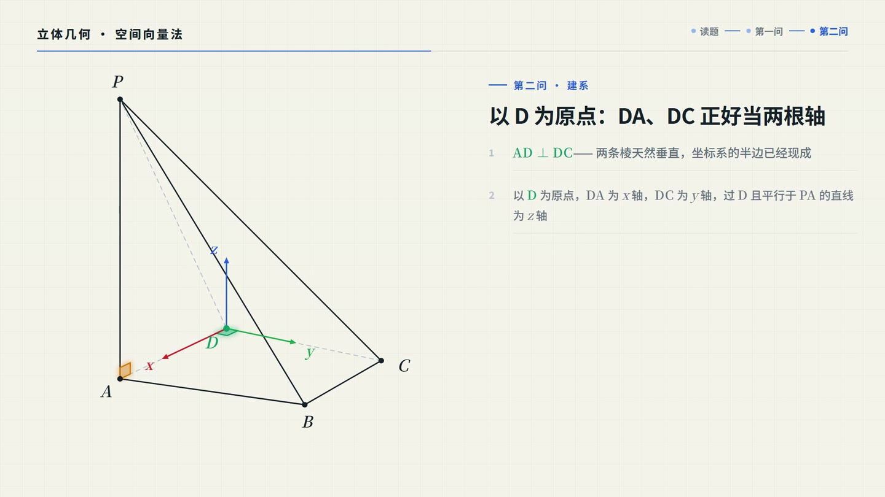
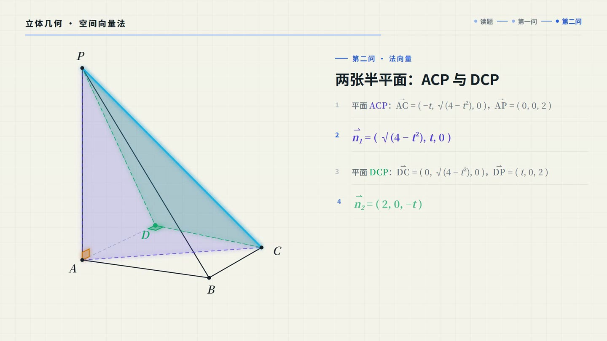
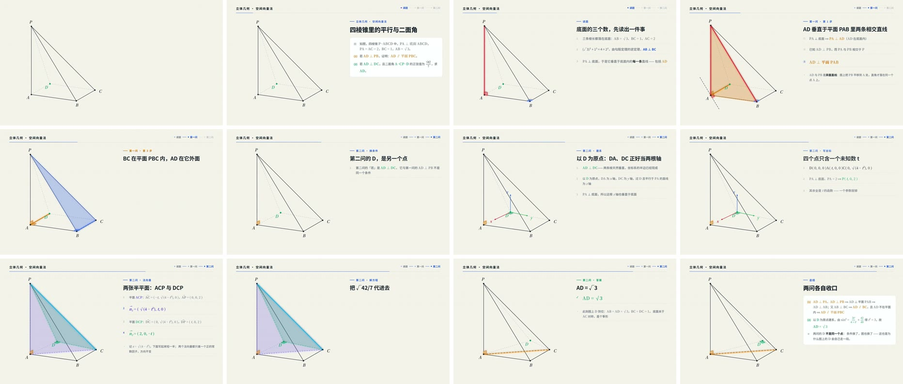

# edu-explainer-video

**把一道题变成一条讲解视频。** 丢一张题图或一段题面进来，agent 自己读题、搭几何图、
排分镜、写符号，渲出 1920×1080 / 30 fps 的成片；要解说就配旁白（逐句对齐到帧），
要给学生点着看就打成可交互 HTML。

这是一个**给 coding agent 用的 skill**：`SKILL.md` 是操作手册，`assets/framework/` 是可直接
运行的 Remotion 工程，`references/` 是看图、加图、避坑的三份资料。装进 skills 目录之后，
你说一句话，agent 读完手册就能自己加一道题、出一条片——分镜、时间轴、排版这些每次都要
重摸一遍的坑，已经沉在里面了。

---

## 它能帮你做什么

| 你的处境 | 它产出什么 |
|---|---|
| 这题想讲清楚——给自己复盘，或给学生看 | 一条 60~90 秒的分步讲解视频：题目卡 → 读题 → 每一问拆成几步 → 结论卡。**结论不是淡入淡出**：图形跟着参数真的动——点滑到位置、平面翻出来、坐标系立在那 |
| 要微课、课件、讲义、公众号素材 | 成片直接可用：H.264 / yuv420p / CRF 18、1920×1080、30 fps、默认静音，想配音再说一句 |
| 想让学生自己点着看 | 可交互 HTML：步骤导航、图形随步骤变化、配音/静默两条时间线可切换 |
| 手上只有一张题图 | 直接丢图。agent 读题 → 判题型 → 挑现成构建器；题图特殊就照 `references/building-figures.md` 现写一个（下面那条片的图就是现写的） |
| 想加新题型 | 26 个构建器当范本；图元只有 line / poly / circle / arrow / marker / text / path 七种，够用 |

**覆盖到的题型**（都是实际出片或逐帧验证过的，不是占位）：立体几何（线面平行与垂直、
二面角、建系向量法、体积、外接球）、解析几何（椭圆弦长最值、定点定值、轨迹）、函数图像
与导数、数列、概率统计、平面几何（圆与内心、两圆、三角形四边形、将军饮马）、物理（受力
分析、运动学、抛体、光学、杠杆滑轮、浮力、电路）、化学（原子结构、分子、实验装置、溶解度曲线）。

**一条成片的规格**：1920×1080 · 30 fps · H.264 · CRF 18 · 默认静音 · 内容文件里没有一个帧号。

---

## 成品长这样

点封面看片（65 秒，静音）：

[](videos/全国1-17/quad-pyramid-dihedral.mp4)

输入只是一张 549×378 的题图：



> 四棱锥 P-ABCD 中，PA ⊥ 底面 ABCD，PA = AC = 2，BC = 1，AB = √3。
> **(1)** 若 AD ⊥ PB，证明：AD ∥ 平面 PBC；**(2)** 若 AD ⊥ DC，且二面角 A-CP-D 的正弦值为 √42/7，求 AD。
>
> 答案 **AD = √3**。

这条片的几个细节，也正好说明了框架的用法：

- **图不是画死的**：底面 ABC 钉死，D 由两个连续参数驱动（`d = |AD|`、`φ = ∠DAC`）。第一问
  `d=1, φ=60°`（ABCD 是矩形），第二问落到 `d=√3, φ=30°`（筝形）。两问的 D 本来就**不是同一个点**，
  所以片子里 D 真的会滑一段——这正是这道题最容易错的地方。
- **虚线会自己走到该去的地方**：八条棱谁实谁虚，按「相邻侧面是否朝向观察者」每帧算一次
  （观察方向 = 投影矩阵的零空间），不是写死的 dash。
- **记号只在成立时出现**：A 处的 AD⊥AB 直角记号带几何校验，D 一离开第一问的位置它就自己消失，
  不会留在画面上撒谎。

四步截屏（原帧取自上面那条成片）：

|  |  |
|:--:|:--:|
|  |  |
| <sub>第一问 · AD 垂直于平面 PAB 里两条相交直线</sub> | <sub>第一问 · AD ∥ BC，而 AD 不在平面 PBC 内</sub> |
|  |  |
| <sub>第二问 · 以 D 为原点建系（DA、DC、竖直方向）</sub> | <sub>第二问 · 二面角的两个半平面与各自法向量</sub> |

整条时间线（每 5.4 秒取一帧）：



---

## 包里有什么

```
edu-explainer-video/
├── SKILL.md                          ← agent 的操作手册，先读这个
├── references/
│   ├── content-api.md                Content 类型的完整字段说明
│   ├── building-figures.md           怎么写一个新的图形构建器
│   ├── gallery/                      每个构建器真实渲染的一帧（22 张）
│   └── lessons-learned.md            踩过的坑，和每个坑换来的一条规则
├── videos/                           成品与题图，README 里的封面和截图都取自这里
│   └── 全国1-17/                     四棱锥 P-ABCD：成片 + 原题图 + 6 张分步截图 + 时间线拼图
└── assets/
    └── framework/                    框架本体（可直接运行的 Remotion 项目）
        ├── src/framework/            编译器、图元渲染器、面板、符号系统、旁白时钟
        │   ├── narration.ts          实测语音 → 每句台词的出现帧
        │   └── builders/             图形构建器 ×26：长方体、椭圆、棱锥、旋转体、
        │                             平面最短路径、物理受力、圆与内心、函数图像、
        │                             数轴、三角形、四边形、两圆、球、向量、统计、
        │                             光学、运动学、抛体、杠杆、滑轮组、浮力、电路、
        │                             原子结构、分子、实验装置、溶解度曲线
        ├── src/player/               浏览器播放器：remotion 的 ~250 行替身 +
        │                             App（步骤导航、配音/静默双时间线）
        ├── src/content/              三道样例题（纯数据）
        ├── narration/                旁白稿样例（circle-incenter.json）
        ├── scripts/
        │   ├── build-fonts.mjs       扫源码 → 重建中文字体子集
        │   ├── check-charset.mjs     漏字体检（只读，可接 CI）
        │   ├── tts.mjs               edge-tts 逐句合成 → 剪静音 → ffprobe 实测
        │   ├── check-narration.ts    屏幕行数 / 配音句数对齐闸门
        │   ├── dump-timeline.ts      导出编译时间线（混音器读它，不重算）
        │   ├── mux-audio.mjs         adelay 逐句铺轨 → 混进视频
        │   ├── verify-sync.mjs       音画机械校验（能量跳变 + 画面变化比）
        │   ├── build-player.mjs      打包可交互 HTML
        │   └── serve-player.mjs      带 Range 的静态服务
        ├── public/fonts/             自托管字体子集 99 KB + 129 KB
        └── README.md                 框架原理
```

---

## 怎么用

### 给 agent 用

把 `edu-explainer-video/` 放进 skills 目录，然后告诉 agent：

> 用 edu-explainer-video 出一道题的视频，题目是：……

（题图也行：把图贴进来即可，agent 自己读题。）

agent 会自己读 `SKILL.md`、挑构建器、写内容文件、注册 composition、体检、渲染，
最后给你 mp4 的路径和校验证据。上面那条 65 秒的片子就是这么来的：新增一个图形构建器
（`builders/quadpyramid.ts`）+ 一个内容文件（`content/quad-pyramid.tsx`），其余一行没改。

### 给自己用

```bash
cp -r assets/framework ./my-video
cd my-video
npm install
npx remotion browser ensure      # 一次性下载 Chrome

npm run studio                   # 逐帧预览
npm run render:cuboid            # 渲染样例一
npm run render:conic             # 渲染样例二
npm run check                    # 漏字体检 + TypeScript + 行数对齐

# 配旁白（edge-tts，需 pip install edge-tts）：
npm run voiced:circle            # 旁白稿 → 合成 → 混音 → 机械校验 → 成片

# 可交互 HTML（带配音 / 不带配音可切换）：
npm run player && npm run serve:player   # -> http://localhost:8080/
```

加一道新题，看 `SKILL.md` 的「Adding a problem」，三步。

---

## 这个框架值钱在哪

**内容即数据。内容文件里不出现任何帧号。**

一道题的内容长这样：

```tsx
{
  id: "ad1",
  heading: "再求向量 AD₁，并算数量积",
  params: { "aux:B1E": 1, "aux:AD1": 1 },
  lines: [ { mark: "5", node: <>…</> }, … ],
}
```

没有 `from`，没有 `durationInFrames`，没有 `interpolate`。每一步多少帧、图形怎么
从这一步过渡到下一步，全部由编译器算出来。参数是增量的——不写的键从上一步继承。

**有旁白时，时钟换成实测的语音。**

旁白稿是独立文件（`narration/<id>.json`），每句念什么、屏幕上那行长什么样，各自
编辑。`tts` 逐句合成、剪掉每段开头约 0.2 秒的静音、ffprobe 实测时长，编译器再拿
这些实测值排出每一句的出现帧——画面和声音是同一组数字的两个消费者，想跑偏都没门。
混音器读的是同一份时间线快照，最后还有一道机械校验：在每个采样点上，语音能量必须
从间隙的 −91 dB 跳到句中的 −16 dB，画面变化必须显著大于它自己的控制组。

**图形是参数的纯函数，不是画死的。**

```ts
{ key: "seg", kind: "line", from: pt(A), to: movingPoint(p.t) }
```

所以「点沿棱滑动」「直线转到最优斜率」「D 从第一问的位置滑到第二问的位置」是改一个数的事，
不是淡入淡出。

**通用性是被验证过的，不是声称的。**

框架里留了两道样例题：长方体立体几何（3D 斜二测投影 + 向量）和椭圆弦长最值
（2D 曲线 + 韦达定理 + 基本不等式）。图形类型、推理方式完全不同，共用同一个
`ProofVideo`。

`builders/` 里其余的构建器——棱锥、旋转体、将军饮马、物理受力、圆与内心、函数图像、
数轴、三角形、四边形、两圆、球、向量、统计、光学、运动学、抛体、杠杆、滑轮组、浮力、
电路、原子结构、分子、实验装置、溶解度曲线——也都是实际出片或逐帧验证过的，
不是占位。选型时先看 SKILL.md 的选型表和 `references/gallery/` 实拍图，再决定要不要自己写。

---

## 为什么有 references/lessons-learned.md

因为这框架是踩着坑长出来的。七个 bug 全都过了类型检查、过了打包、大部分还过了
渲染，全都不在语法层和算法层。

其中一个是**几何事实错误**：AI 在两条异面直线的「交点」上画了直角标记，因为
「垂直就该相交」这个桌面直觉。这是最贵的一类错——它看起来像证明。

Skill 里有完整记录。改框架之前值得先读一遍。

---

## 许可

MIT，见 [LICENSE](LICENSE)。`assets/framework/public/fonts/` 下的中文字体子集由
Google Fonts（Noto Sans SC / Noto Serif SC）按 SIL Open Font License 生成并自托管。
